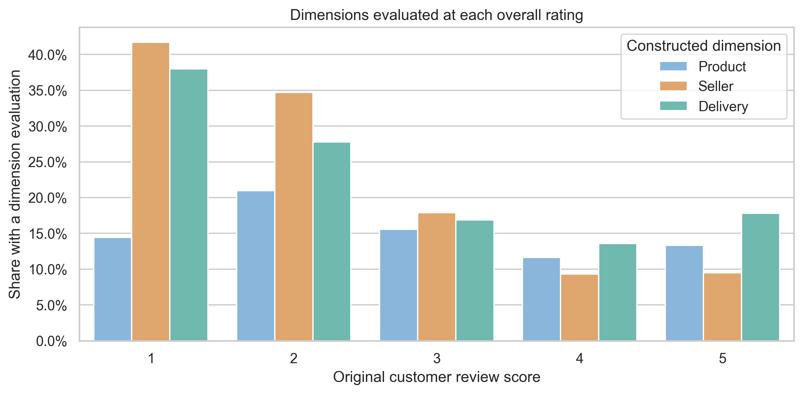
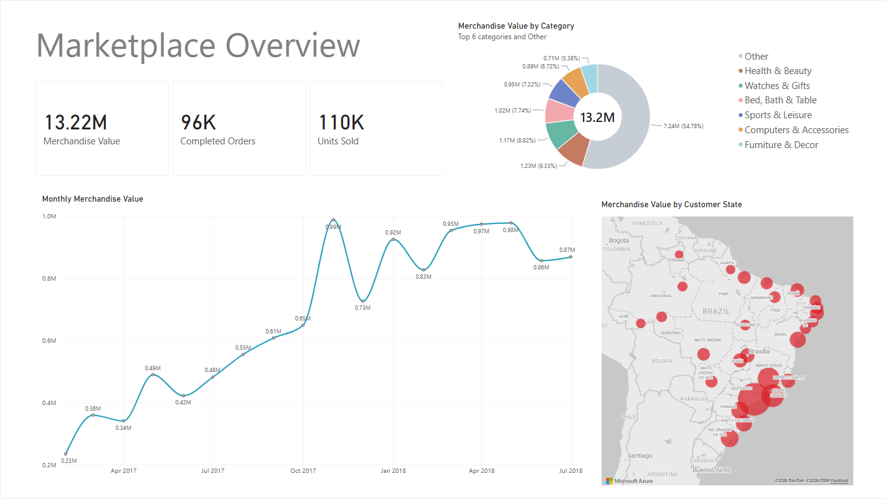
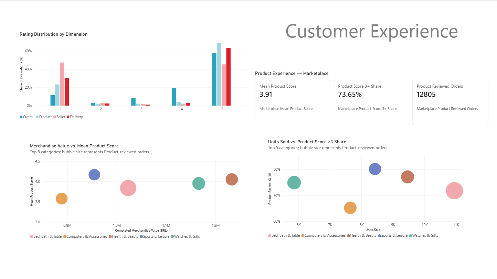

# Olist E-Commerce Analysis: Business Performance and Customer Experience

A Python-based analysis of the Olist Brazilian e-commerce dataset, examining marketplace performance, delivery outcomes, and customer experience. LLM-assisted review scoring derives separate Product, Seller, and Delivery evaluations to investigate how commercial performance relates to customer experience.

## Project Overview

This project analyzes the [Brazilian E-Commerce Public Dataset by Olist](https://www.kaggle.com/olistbr/brazilian-ecommerce), comprising nine related tables covering approximately 100,000 orders from 2016 to 2018, to investigate marketplace performance and customer experience.

- **Business Performance:** How is commercial activity distributed over time, geographically, and across customers, product categories, and sellers? How does delivery lateness vary with distance and across sellers?
- **Customer Experience:** What do reviews reveal separately about products, sellers, and delivery, and how do these evaluations relate to the original overall customer ratings?
- **Business Performance vs Customer Experience:** How do category merchandise value and seller order volume relate to Product and Seller scores, respectively?

The original dataset provides an overall customer rating but no separate evaluations of products, sellers, or delivery. This project constructs these scores from review text using LLM-assisted analysis, enabling more detailed investigation of customer experience and its relationship with commercial performance.

## Contents

- [Key Findings](#key-findings)
- [Power BI Dashboards](#power-bi-dashboards)
- [Data and Methodology](#data-and-methodology)
- [Technology Stack](#technology-stack)
- [Future Work and Data Collection Recommendations](#future-work-and-data-collection-recommendations)
- [Repository Structure and Reproduction](#repository-structure-and-reproduction)

## Key Findings

### Business Performance

**Growth was driven primarily by higher item volume.** Completed merchandise value increased approximately **134.4% year-on-year**, comparing February–July 2018 with the same period in 2017 ([supporting figure](figures/monthly_merchandise_value_and_yoy_growth.png)). Merchandise value per item remained comparatively stable over the main observation window, indicating that growth primarily reflected an increase in completed item volume rather than value per item.


*Completed merchandise value and value per item, indexed to February 2017 = 100.*

**Commercial activity was highly concentrated among sellers.** The top **10% of sellers with at least one completed order**, ranked by merchandise value, accounted for approximately **68% of total completed merchandise value** ([supporting figure](figures/seller_commercial_concentration.png)).

### Customer Experience

**Constructed experience scores closely track overall customer ratings.** Among reviews containing a Product, Seller, or Delivery evaluation, mean scores for all three dimensions increased consistently with the original overall customer rating ([supporting figure](figures/dimension_score_vs_original_rating.png)).

**Seller and Delivery evaluations appeared more frequently in low-rated reviews.** Among 1-star reviews, approximately **42%** contained Seller evaluations and **38%** contained Delivery evaluations, compared with **9%** and **18%** among 5-star reviews. Product evaluations showed a less consistent pattern across rating levels.



*Share of analyzed reviews containing an evaluation of each dimension, grouped by original overall customer rating.*

**Late deliveries received substantially lower Delivery scores.** Among reviews submitted on or after delivery, orders delivered by their estimated date received a mean Delivery score of **4.29** (14,749 orders), compared with **2.24** (410 orders) for late deliveries ([supporting figure](figures/delivery_score_by_lateness_and_review_timing.png)).

### Commercial Scale vs Customer Experience

**Higher category merchandise value did not consistently correspond to stronger Product evaluations.** Among the ten largest categories by completed merchandise value, **Computers/Accessories** had the lowest mean Product score (**3.58**), with **34.8% of its 756 eligible reviewed orders** receiving scores below 3.


*Completed merchandise value and mean Product score by category. Bubble size represents the number of eligible Product-reviewed orders.*

**Higher seller order volume did not consistently correspond to stronger Seller evaluations.** Mean Seller scores showed no clear upward relationship with completed-order volume among sellers with at least ten eligible reviewed orders ([supporting figure](figures/seller_volume_vs_seller_experience.png)).

[Full analysis notebook](notebooks/05_business_performance.ipynb)

## Power BI Dashboards

Two interactive Power BI reports complement the notebook analysis, enabling exploration of marketplace performance and customer experience. Both reports are available online, with the Power BI project files provided for download.

### Marketplace Performance

[Explore Interactive Report](https://app.powerbi.com/view?r=eyJrIjoiZGJhNzA5MDAtMzA5NC00Y2VhLWEwMDEtZjRlMTZjYjNiNTRkIiwidCI6IjE2ZGVlZGU4LTc5ZTktNGUzMy05OWU2LTlkOGQzOTQyZDc5NiIsImMiOjEwfQ%3D%3D) · [Download Power BI File](dashboard/olist_marketplace_performance.pbix)

The report contains two pages:

- **Marketplace Overview:** Completed orders, items sold, merchandise value trends, product category composition, and geographic distribution of customer demand.
- **Marketplace Dynamics:** Year-on-year comparisons of commercial activity, changes in category and geographic distributions, and interactive filtering by product price band.



*Marketplace Overview.*

### Customer Experience

[Explore Interactive Report](https://app.powerbi.com/view?r=eyJrIjoiODBkZTEyNGEtZGE0OC00YTVmLTg0NGUtZGQyMTUzMWQ0YzI1IiwidCI6IjE2ZGVlZGU4LTc5ZTktNGUzMy05OWU2LTlkOGQzOTQyZDc5NiIsImMiOjEwfQ%3D%3D) · [Download Power BI File](dashboard/olist_customer_experience.pbix)

The report presents Product, Seller, and Delivery score distributions alongside category-level comparisons of commercial scale and Product evaluations. The two category scatterplots display the top five categories, providing a more focused view than the broader notebook analysis. Bubble sizes indicate the number of eligible Product-reviewed orders.



*Customer Experience.*

## Data and Methodology

### Data Sources and Relationships

The Olist dataset contains nine related tables covering orders, order items, customers, sellers, products, category translations, payments, reviews, and geolocation records.


Customer and seller locations are cleaned using official references from the **Brazilian Institute of Geography and Statistics (IBGE)**: [Territorial Division of Brazil 2018](https://geoftp.ibge.gov.br/organizacao_do_territorio/estrutura_territorial/divisao_territorial/2018/) and [Municipal Toponymic Changes](https://www.ibge.gov.br/geociencias/organizacao-do-territorio/estrutura-territorial/27336-alteracoes-toponimicas-municipais.html). Locations that cannot be reliably matched are left unresolved rather than assigned an uncertain municipality. 

### Analytical Workflow

The analysis is organized into five notebooks, covering data understanding, cleaning and validation, review translation, rating construction, and the final analysis.


#### 1. Data Understanding

[01_data_understanding.ipynb](notebooks/01_data_understanding.ipynb)

The first notebook audits table granularity, identifiers, one-to-many relationships, order lifecycle fields, geographic inconsistencies, review duplication, and missing product-category information. Particular attention is given to orders containing multiple items or sellers, the distinction between `customer_id` and `customer_unique_id`, and non-one-to-one review–order relationships. These checks establish how the raw records can be reliably linked and aggregated for subsequent analysis.

#### 2. Data Cleaning and Validation

[02_data_cleaning.ipynb](notebooks/02_data_cleaning.ipynb)

The second notebook validates timestamp availability and consistency against order status, normalizes geographic labels, and constructs representative geographic lookup data for distance calculations.

It also investigates duplicated and ambiguous review–order relationships to establish conservative attribution rules. Review IDs associated with multiple orders are excluded from entity attribution rather than assigned arbitrarily, while distinct reviews of the same order are preserved. Product, Seller, and Delivery evaluations are attributed only when their targets are unambiguous. Among retained review IDs, **96.1%** are Product-attributable and **98.0%** are Seller/Delivery-attributable.

#### 3. Review Translation

[03_review_translation.ipynb](notebooks/03_review_translation.ipynb)

Portuguese review comments are translated into English using a local neural machine translation model. Translation is performed once per unique review text, with results saved incrementally and mapped back to the original review records. Non-informative comments and remaining untranslated records are handled explicitly.

#### 4. Review-Based Rating Construction

[04_rating_construction.ipynb](notebooks/04_rating_construction.ipynb)

A sample of 2,000 translated reviews is examined using sentence embeddings and nearest-neighbor analysis to identify recurring evaluation topics and define 15 candidate aspects. An LLM then extracts aspect-level evaluations from the **original Portuguese comments**, including attitude and discourse information.

Repeated or opposing evaluations are consolidated, and the extracted aspects are mapped to separate **Product**, **Seller**, and **Delivery** scores on a 1–5 scale. Overall or unassignable evaluations are excluded, and dimensions not mentioned in a review remain unscored. For score-distribution analysis, scores below 3 are classified as low, while scores of 3 or above are classified as non-low.

#### 5. Business Performance and Customer Experience

[05_business_performance.ipynb](notebooks/05_business_performance.ipynb)

The final notebook integrates the prepared marketplace data and constructed ratings in three stages:

1. **Business Performance** — Customer, Product / Category, Seller, and Delivery.
2. **Customer Experience** — Product, Seller, Delivery, and the original Overall rating.
3. **Business Performance vs Customer Experience** — category commercial scale vs Product experience and seller commercial scale vs Seller experience.

The analysis maintains separate order-level and item-level measures to avoid duplicated totals when combining related tables. Completed commerce is based on delivered orders, with merchandise value calculated from item prices excluding freight.

For customer experience, the latest available score is selected separately for each order and dimension, retaining an earlier evaluation when a later review does not mention that dimension. Eligibility also depends on the analytical question: Product evaluations require the order to have been received before review submission, Seller evaluations may include non-delivered orders, and Delivery evaluations are distinguished by review timing relative to delivery.

Comparisons with the original overall customer rating instead use evaluations from the same review records, without applying the order-level selection or entity-attribution filters. Category comparisons require at least 30 eligible reviewed orders, seller-level Seller-score comparisons require at least 10, and the separate seller distance-benchmark analysis requires 30 distance-eligible orders.

## Technology Stack

- **Python:** pandas and NumPy for data analysis; Matplotlib and Seaborn for visualization.
- **Hugging Face Transformers & ONNX Runtime:** Local Portuguese–English review translation.
- **Sentence Transformers & PyTorch:** Sentence embeddings and nearest-neighbor analysis of review topics.
- **Google Gemini API:** Structured extraction of review evaluations using a custom prompt and JSON response schema.
- **Power BI:** Interactive marketplace performance and customer experience reports.

Environment specifications and dependencies are documented in [ENVIRONMENT.md](ENVIRONMENT.md) and [environment.yml](environment.yml).

## Future Work and Data Collection Recommendations

The analysis highlights several limitations in the available data that could be addressed through improved data collection and database design:

- **Customer history:** Although `customer_unique_id` allows purchases from the same customer to be linked across orders, relatively few repeat purchases are observed in the available data. A longer observation window or richer longitudinal transaction history would better support retention, cohort, and repeat-purchase analysis.
- **Logistics information:** Late-delivery rates increase with seller–customer distance, but sellers with similar distance-based expectations can still show substantially different outcomes. Additional logistics fields—especially the **carrier/logistics service provider**, shipping service type, and carrier-side tracking events—would help distinguish geographic effects from differences in logistics and operational performance.
- **Review structure:** Reviews are recorded at the **order level**, even when an order contains multiple products or sellers. Collecting reviews at the **order-item level**, with explicit links to `order_item_id`, `product_id`, and `seller_id`, would allow Product and Seller evaluations to be attributed directly rather than inferred from the composition of the order.
- **Geographic data design:** City is stored as a **free-text field**, which introduces spelling variations, formatting inconsistencies, and historical-name differences. Using a controlled geographic field—such as an enumerated municipality reference or official IBGE municipality code—as the canonical location identifier would substantially reduce the need for downstream geographic normalization.
- **Order-lifecycle validation:** A small number of records show inconsistencies between `order_status` and lifecycle timestamps, such as delivered orders with missing timestamps or canceled orders with apparently complete fulfillment histories. Stronger validation constraints and explicit exception or cancellation reasons would make these records easier to interpret downstream.

## Repository Structure and Reproduction

### Repository Structure

```
olist-ecommerce-analysis/
├── dashboard/
│   ├── data/                        # Prepared Power BI datasets
│   ├── previews/                    
│   ├── olist_marketplace_performance.pbix
│   └── olist_customer_experience.pbix
├── data/
│   ├── raw/                         # Geographic references and source-data instructions
│   │   └── README.md                
│   └── processed/                   # Cleaned and intermediate datasets
├── figures/                         # Analytical figures and diagrams
├── notebooks/
│   ├── .env.example                    # Gemini API-key template
│   ├── 01_data_understanding.ipynb
│   ├── 02_data_cleaning.ipynb
│   ├── 03_review_translation.ipynb
│   ├── 04_rating_construction.ipynb
│   └── 05_business_performance.ipynb
├── src/
│   ├── geo_clean.py                 # Geographic normalization and lookup
│   ├── embeddings.py                # Sentence embeddings and KNN analysis
│   ├── aspect_extraction.py         # Aspect extraction and score aggregation
│   ├── aspect_schema.json           # Structured LLM response schema
│   ├── aspect_extraction_prompt.md  # Review aspect-extraction prompt
│   └── aspect_extraction_prompt_design.md  # Prompt design and rationale
├── ENVIRONMENT.md                   # Environment and compatibility notes
├── environment.yml                  # Conda environment specification
├── environment-lock-win-64.txt      # Locked Windows dependencies
├── .gitignore                       
├── LICENSE                          
└── README.md                        
```

Browse: [Data](data/) · [Notebooks](notebooks/) · [Figures](figures/) · [Source Code](src/) · [Power BI Reports](dashboard/) · [Environment Documentation](ENVIRONMENT.md)

### Reproducing the Analysis

The repository includes saved notebook outputs, intermediate datasets, and Power BI reports, allowing readers to inspect the results without regenerating the entire workflow.

1. **Set up the environment.** Use [environment.yml](environment.yml) to recreate the Conda environment. See [ENVIRONMENT.md](ENVIRONMENT.md) for compatibility notes. The project was developed on Windows 11 with Python 3.11.
2. **Obtain the source data.** Download the [Olist dataset](https://www.kaggle.com/datasets/olistbr/brazilian-ecommerce) and place the CSV files in `data/raw/`, following the [data instructions](data/raw/README.md). The required IBGE geographic reference datasets are already included in the repository.
3. **Rerun the final analysis using saved intermediate data.** The repository includes the processed product reference, geographic, review translation, attribution, and rating datasets. These can be reused to run the [final analysis notebook](notebooks/05_business_performance.ipynb) without repeating the preceding data preparation and NLP workflows.
4. **Regenerate the complete workflow.** Run notebooks in dependency order: **01 → 03 → 02 → 04 → 05**. Translation and embedding require the corresponding local models. For LLM extraction, open `notebooks/.env.example`, replace the placeholder with your own `GEMINI_API_KEY`, and rename the file to `.env` in the same directory. The `.env` file is excluded from version control. Gemini API usage may incur charges.

The Power BI `.pbix` files can be opened separately in Power BI Desktop. Refreshing their underlying data is a separate process from executing the analytical notebooks.