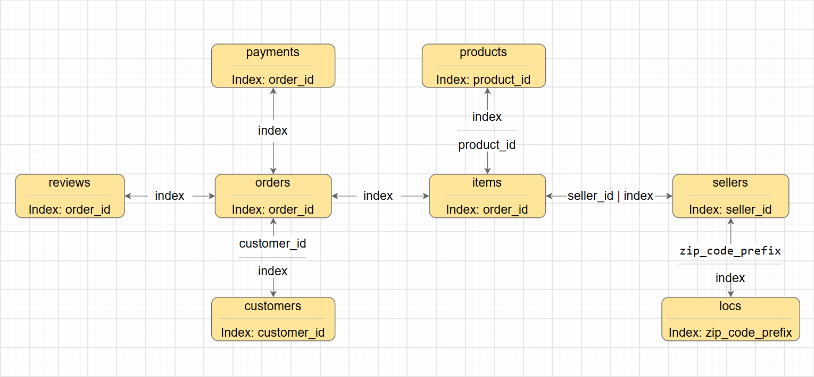
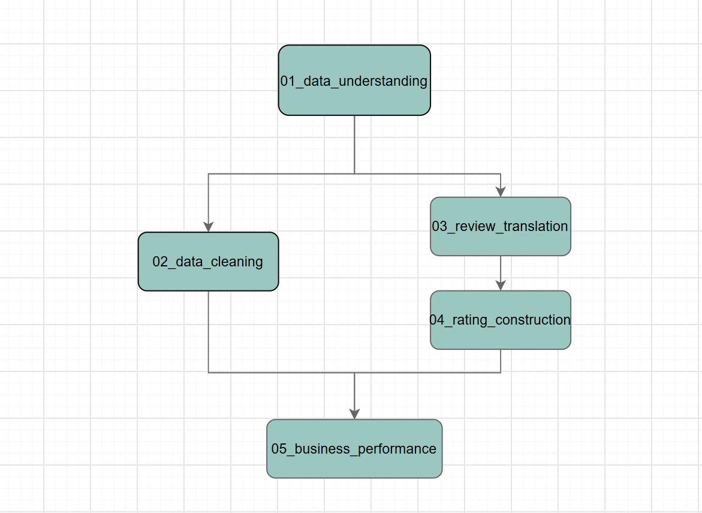
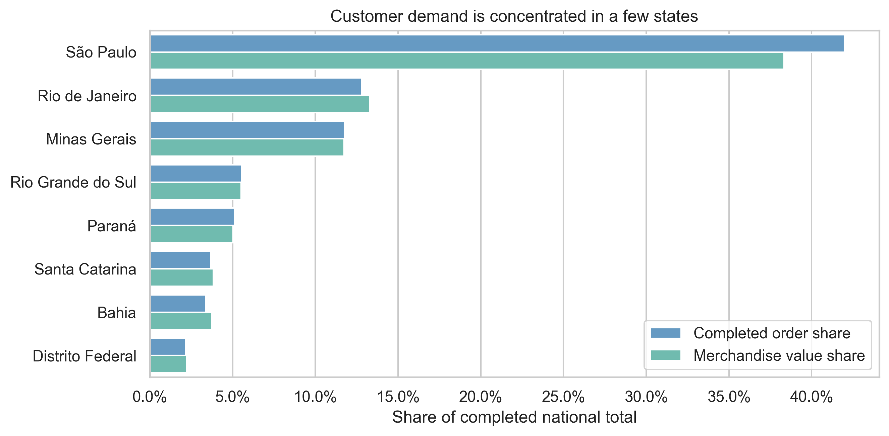
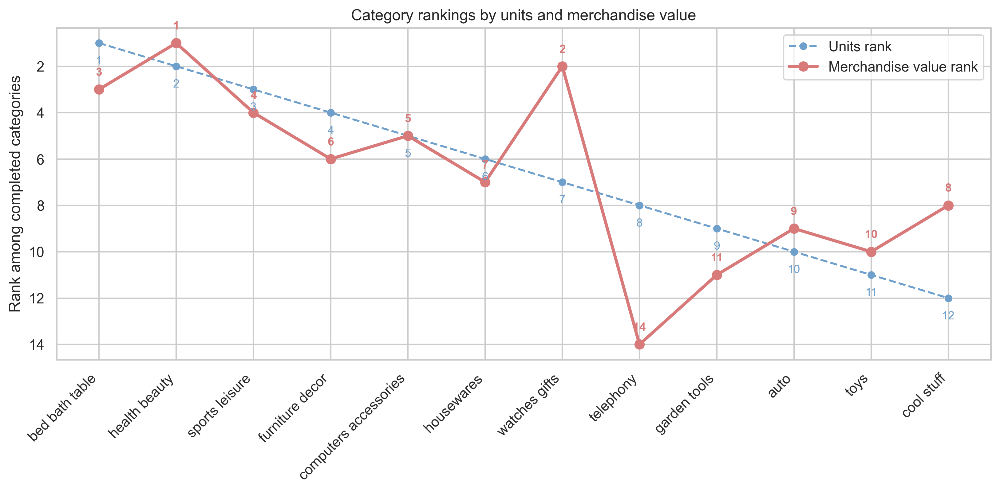
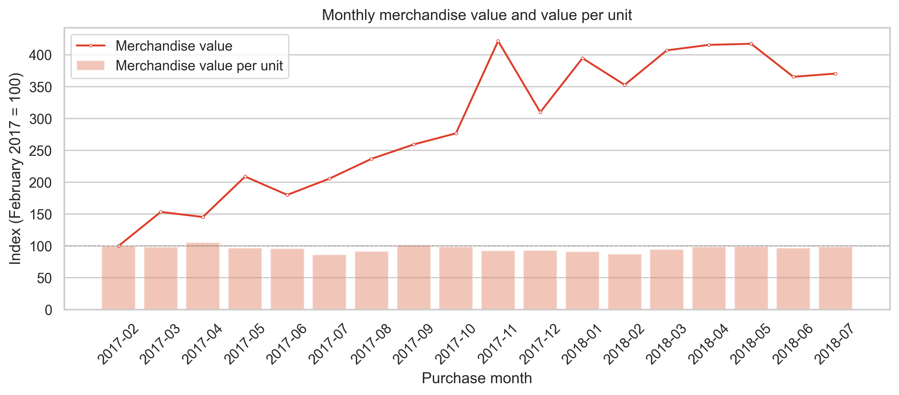
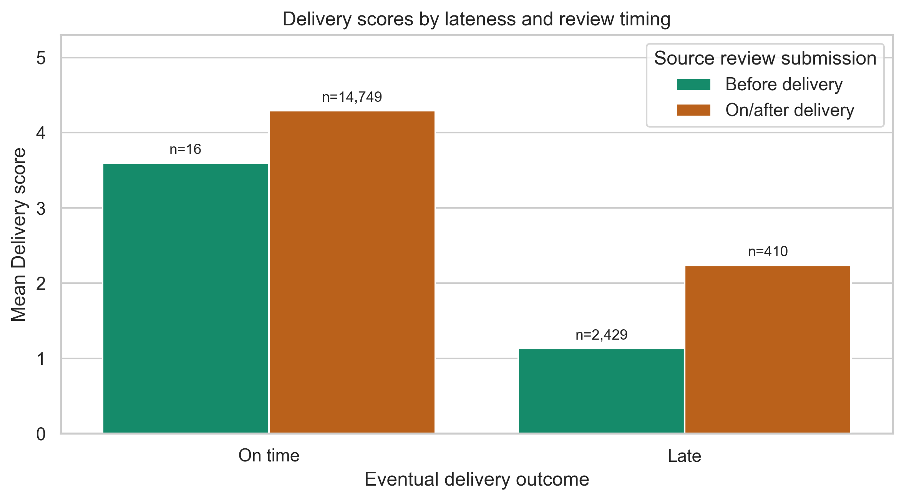
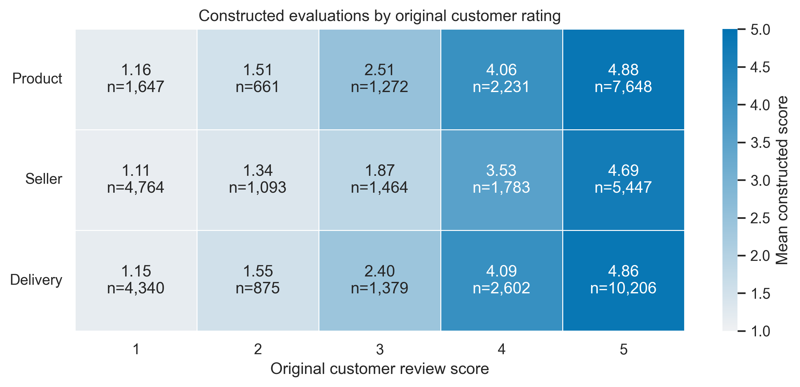
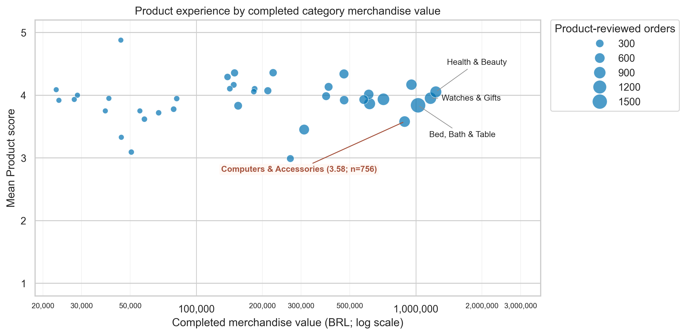
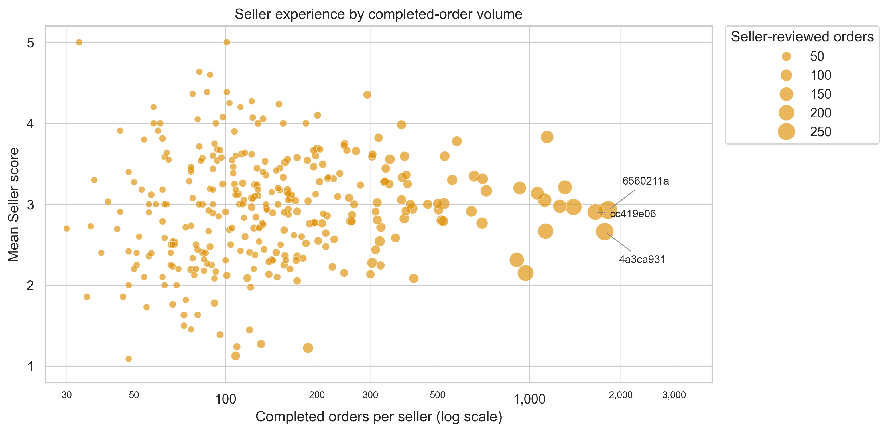

# olist-ecommerce-analysis

End-to-end Python data analysis project on the Olist Brazilian e-commerce dataset, combining conventional data analysis with LLM-assisted review scoring through APIs.

## Project Overview

This project examines the Olist marketplace from two complementary perspectives: **Business Performance** and **Customer Experience**.

The workflow begins by auditing the raw relational tables and resolving data-quality issues that affect downstream analysis. Customer and seller locations are cleaned against official Brazilian geographic references, and review-to-order relationships are examined carefully before reviews are attributed to Product, Seller, and Delivery targets.

Because the original dataset provides only one overall customer rating, the project also constructs separate **Product**, **Seller**, and **Delivery** ratings from review text. Portuguese comments are translated into English for exploratory review analysis, recurring aspects are identified with sentence embeddings and nearest-neighbor inspection, and an LLM extracts aspect-level evaluations that are aggregated into the three constructed dimensions.

The final analysis combines these prepared datasets to examine marketplace structure, commercial activity, delivery performance, customer experience, and the relationship between commercial scale and experience.

## Dataset

### Original Dataset

The primary data source is the [Brazilian E-Commerce Public Dataset by Olist](https://www.kaggle.com/olistbr/brazilian-ecommerce), which contains approximately 100,000 orders placed between 2016 and 2018 across multiple marketplaces in Brazil. 



The dataset contains the following Olist tables:

- orders and order items;
- customers and sellers;
- products and product-category translations;
- payments;
- customer reviews;
- geolocation records.

### Official Geographic References

The city labels provided in the Olist customer, seller, and geolocation tables contain inconsistencies that require additional validation and cleaning. To resolve them conservatively, the project uses official geographic reference data from the **Brazilian Institute of Geography and Statistics (IBGE)**.

The main references are:

- [IBGE Territorial Division of Brazil 2018 (DTB)]((https://geoftp.ibge.gov.br/organizacao_do_territorio/estrutura_territorial/divisao_territorial/2018/)), which provides official municipality and district names and codes; 
- [IBGE Municipal Toponymic Changes](https://www.ibge.gov.br/geociencias/organizacao-do-territorio/estrutura-territorial/27336-alteracoes-toponimicas-municipais.html), used to identify historical municipality names and official name changes.

These references are used only to standardize and resolve geographic labels rather than to replace the original marketplace records.

### Data Characteristics and Analytical Definitions

Several structural characteristics of the Olist data affect how the analysis is designed:

- One order may contain multiple items and may involve multiple sellers.
- `customer_id` identifies the customer record associated with an individual order, while `customer_unique_id` identifies the same underlying customer across multiple orders.
- Review and order records are not always one-to-one, so review attribution requires additional validation before Product, Seller, and Delivery scores can be linked to marketplace entities.
- Some products have missing category information.
- Order lifecycle status affects which fulfillment timestamps are expected to be available and therefore how missing timestamps should be interpreted.

For the final commercial analysis:

- an order is treated as **completed** when `order_status == 'delivered'`;
- **merchandise value** is defined as the sum of item prices and excludes freight;
- metrics are constructed at the appropriate grain rather than by merging all source tables into a single flat dataset.

## Business Questions 

The project focuses on the following questions:

1. How is completed marketplace activity distributed across customers, product categories, and sellers?
2. How does completed merchandise value develop over time, and is growth driven primarily by item volume or by value per item?
3. How are late deliveries associated with seller-customer distance, and how much seller-level variation remains beyond that distance pattern?
4. What do customer reviews reveal separately about Product, Seller, and Delivery experience?
5. How do the constructed experience scores relate to the original overall customer rating?
6. Do commercially larger product categories or sellers systematically receive stronger customer-experience evaluations?

## Methodology (==notebook/analysis organization==)

The analysis is organized as a five-notebook workflow.



### 1. Data understanding

[`01_data_understanding.ipynb`](notebooks/01_data_understanding.ipynb)

The first notebook audits table granularity, identifiers, one-to-many relationships, order lifecycle fields, geographic inconsistencies, customer identifiers, review duplication, and missing product-category information. The purpose is to establish how the raw tables should be interpreted before they are combined for analysis.

### 2. Data cleaning and validation

[`02_data_cleaning.ipynb`](notebooks/02_data_cleaning.ipynb)

The second notebook:

- validates timestamp availability against the order lifecycle;
- resolves inconsistent geographic labels using official IBGE references;
- constructs representative geographic lookup data;
- investigates duplicated and ambiguous review-order relationships;
- defines conservative Product, Seller, and Delivery attribution rules.

Ambiguous review IDs associated with multiple orders are excluded from entity attribution rather than assigned arbitrarily. After this treatment, 96.1% of retained reviews are attributable to a specific Product target and 98.0% to Seller and Delivery targets.

### 3. Review translation

[`03_review_translation.ipynb`](notebooks/03_review_translation.ipynb)

Portuguese review comments are translated into English with a local neural machine translation workflow. Translation is performed once per unique review text, saved incrementally, and then mapped back to the original review records. Non-informative comments and remaining untranslated records are handled explicitly.

### 4. Review-based rating construction

[`04_rating_construction.ipynb`](notebooks/04_rating_construction.ipynb)

The rating workflow first uses sentence embeddings and nearest-neighbor inspection to identify recurring review topics and define a controlled set of candidate aspects. An LLM then extracts aspect-level evaluations, including attitude and discourse information. These evaluations are consolidated and aggregated into separate **Product**, **Seller**, and **Delivery** scores on a 1-5 scale.

### 5. Business Performance and Customer Experience

[`05_business_performance.ipynb`](notebooks/05_business_performance.ipynb)

The final notebook integrates the cleaned marketplace data and constructed ratings in three stages:

1. **Business Performance** — Customer, Product / Category, Seller, and Delivery.
2. **Customer Experience** — Product, Seller, Delivery, and the original Overall rating.
3. **Business Performance vs Customer Experience** — category commercial scale vs Product experience and seller commercial scale vs Seller experience.

The analysis preserves the appropriate grain for each question, validates joins, separates completed commerce from all recorded activity, and avoids treating descriptive associations as causal effects.

## Key Findings

### 1. Business Performance

#### Main findings

- Customer demand is geographically concentrated. In the completed-order state summary, São Paulo accounts for about 42% of completed orders, while São Paulo, Rio de Janeiro, and Minas Gerais together account for roughly two thirds.
- Category importance depends on the commercial measure used. By completed item volume, categories such as **Bed/Bath/Table** are especially prominent, while by completed merchandise value, **Health/Beauty** and **Watches/Gifts** rank among the strongest contributors.
- Completed merchandise value rises substantially over the central observation window, while merchandise value per item remains comparatively stable. The increase in total value is therefore primarily associated with higher completed item volume.
- Seller activity is highly concentrated: the largest 10% of active sellers by completed merchandise value account for about **68%** of total completed value.
- Late-delivery rates increase with seller–customer distance, although substantial variation remains between sellers with similar distance-based benchmarks.

#### Selected illustrations

**Customer demand by state**



**Category rankings by units and merchandise value**



**Monthly merchandise value and value per unit**



---

### 2. Customer Experience

#### Main findings

- Product evaluations are generally favorable but still vary across categories.
- Seller evaluations contain substantially more low scores and show considerable variation across sellers.
- Delivery evaluations are strongly polarized. Among evaluations submitted on or after delivery, late deliveries receive markedly lower mean Delivery scores than on-time deliveries, and the longest delays receive particularly low evaluations.
- Within reviews containing a constructed dimension evaluation, Product, Seller, and Delivery scores all rise closely with the original overall customer rating.
- At the same time, the dimensions customers choose to evaluate are not equally represented across rating levels, so the constructed-score populations are selective subsets of the full review population.

#### Selected illustrations

**Delivery scores by lateness and review timing**



**Constructed scores by original customer rating**



---

### 3. Business Performance vs Customer Experience

#### Main findings

- Commercial scale and customer experience provide complementary rather than interchangeable views of marketplace performance.
- Categories with greater completed merchandise value do **not** systematically receive higher Product scores.
- Sellers with greater completed-order volume do **not** systematically receive higher Seller scores.

#### Selected illustrations

**Product experience by completed category merchandise value**



**Seller experience by completed-order volume**



## Repository Structure

```text
olist-ecommerce-analysis/
├── data/
│   ├── raw/                         # Olist and geographic reference inputs
│   └── processed/                   # Cleaned, translated, and analysis-ready outputs
├── figures/                         # Saved analytical figures
├── notebooks/
│   ├── 01_data_understanding.ipynb
│   ├── 02_data_cleaning.ipynb
│   ├── 03_review_translation.ipynb
│   ├── 04_rating_construction.ipynb
│   └── 05_business_performance.ipynb
├── src/
│   ├── geo_clean.py                 # Geographic normalization and resolution
│   ├── embeddings.py                # Sentence embedding and KNN utilities
│   ├── aspect_extraction.py         # Review extraction and score aggregation
│   ├── aspect_schema.json
│   ├── aspect_extraction_prompt.md
│   └── aspect_extraction_prompt_design.md
└── README.md
```

## Tools Used

- **Data analysis:** Python, pandas, NumPy
- **Visualization:** Matplotlib, Seaborn
- **Geographic validation:** official IBGE municipality, district, and historical toponym reference files
- **Review translation:** Hugging Face Transformers, Optimum / ONNX Runtime, `R4kSo1997/opus-mt-pt-en-onnx-int8`
- **Sentence embeddings:** `sentence-transformers/all-MiniLM-L6-v2`, Transformers, PyTorch
- **Aspect extraction:** Google Gemini API with a structured JSON schema and reusable extraction prompt
- **Project organization:** reusable Python modules under `src/`, ==Git, and GitHub==

The LLM-based aspect-extraction notebook expects a `GEMINI_API_KEY` in a local `.env` file. The `.env` file should remain outside version control. (==put in Repository Structure==)

## Future Work and Data Collection Recommendations

The analysis highlights several limitations in the available data that could be addressed through improved data collection and database design:

- **Customer history:** Although `customer_unique_id` allows purchases from the same customer to be linked across orders, relatively few repeat purchases are observed in the available data. A longer observation window or richer longitudinal transaction history would better support retention, cohort, and repeat-purchase analysis.

- **Logistics information:** Seller–customer distance explains part of the variation in late-delivery rates, but sellers with similar distance-based expectations can still show substantially different outcomes. Additional logistics fields—especially the **carrier / logistics service provider**, shipping service type, and carrier-side tracking events—would help distinguish geographic effects from differences in logistics and operational performance. 

- **Review structure:** Reviews are recorded at the **order level**, even when an order contains multiple products or sellers. Collecting reviews at the **order-item level**, with explicit links to `order_item_id`, `product_id`, and `seller_id`, would allow Product and Seller evaluations to be attributed directly rather than inferred from the composition of the order. 

- **Geographic data design:** City is stored as a **free-text field**, which introduces spelling variations, formatting inconsistencies, and historical-name differences. Using a controlled geographic field—such as an enumerated municipality reference or official IBGE municipality code—as the canonical location identifier would substantially reduce the need for downstream geographic normalization.

- **Order-lifecycle validation:** A small number of records show inconsistencies between `order_status` and lifecycle timestamps, such as delivered orders with missing timestamps or canceled orders with apparently complete fulfillment histories. Stronger validation constraints and explicit exception or cancellation reasons would make these records easier to interpret downstream.
